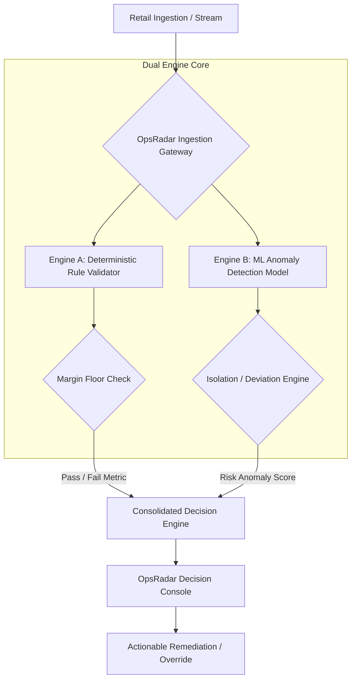

# OpsRadar: Revenue Protection & Decision Console 🛡️

> **A dual-engine retail decision console combining rule-based margin safeguards with predictive machine learning anomaly detection to prevent catastrophic revenue leakage.**

---

## ⚡ Core Problem & Solution

Retailers lose millions every year due to pricing configuration errors, sudden margin erosion, and undetected checkout-level transaction discrepancies. Standard rule engines often fail on dynamic volume anomalies, while pure black-box ML models miss deterministic pricing edge-cases.

**OpsRadar introduces a Dual-Engine Decision Architecture:**
1. **Engine A (Deterministic Guardrails):** Instant evaluation of hard business logic, minimum margins, supplier unit floor prices, and contractual price floors.
2. **Engine B (Predictive Anomaly Detector):** Unsupervised/semi-supervised ML model running inference on batch and live transactions to flag abnormal pricing drift, discount abuse, and margin volatility.

---

## 🏗️ System Architecture

**Track 4: Business Decision-Support / Retail Intelligence**
**Team:** Cool (Mohith & Abhay)

## 1. Executive Summary
OpsRadar is an operational decision console that surfaces active retail margin leaks, diagnoses drivers, and enables real-time manager intervention.

## 2. ML Methodology & Dual-Engine Triage
1. **Deterministic Margin Safeguard (Rule Engine):** Flags transactions where unit price is below cost basis ($P_{unit} < C_{unit}$).
2. **Unsupervised Anomaly Detector (Isolation Forest - Trained from Scratch):** Trained on multi-dimensional transaction features (`quantity`, `unit_price`, `discount_pct`, `gross_revenue`) to isolate behavioral outliers missed by single-variable rules.
3. **Data Science Insight:** Classification models targeting `status` yielded validation ROC-AUC of ~0.49–0.50, revealing `status` was statistical noise in this dataset. We executed an honest pivot to forensic margin quantification and anomaly isolation.

## 3. Key Findings
- **Total Transactions Analyzed:** 18,000 unified records across catalog, customer, inventory, and campaign datasets.
- **Confirmed Cost Drag:** $1,396,782.81 in gross margin loss across 5,947 below-cost sales.
- **ML Anomaly Discovery:** 703 multivariate anomalies isolated.
- **Critical Overlap:** 196 transactions flagged by both engines (Tier-1 urgent triage).
- **Zero-Conversion Ad Waste:** $7,459.97 identified from unconverting marketing campaigns.

## 4. Run Instructions
pip install -r requirements.txt && streamlit run app.py
